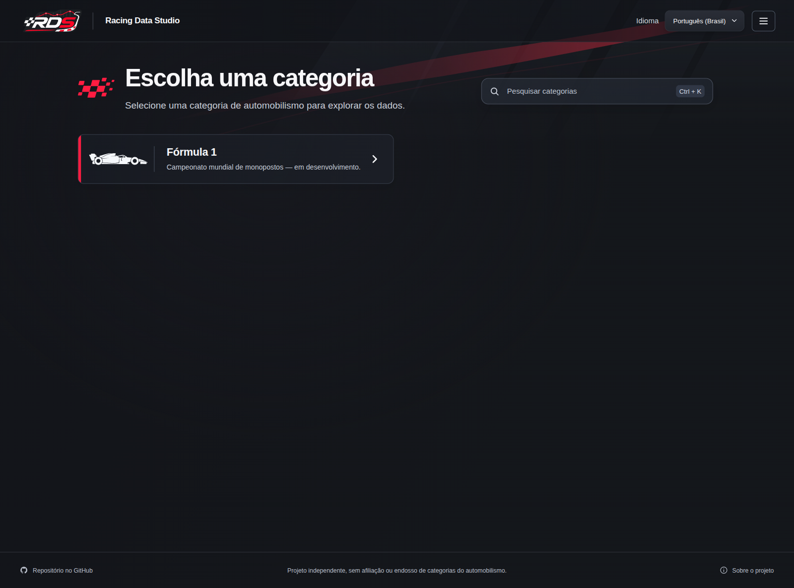
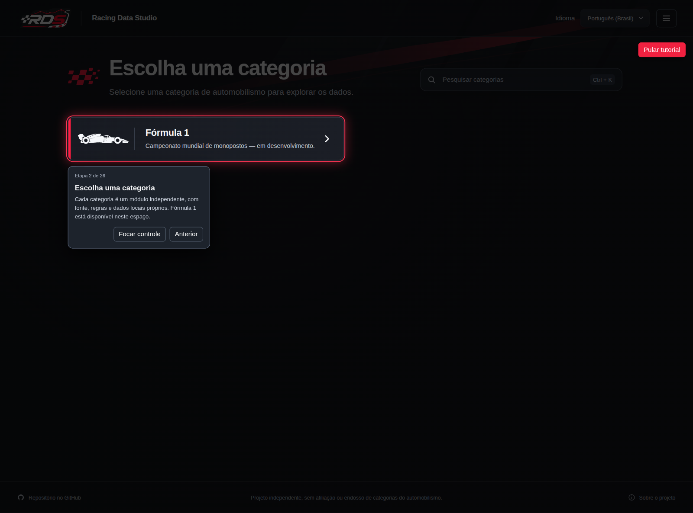

# Racing Data Studio

> [!WARNING]
> **Open beta:** Help test Racing Data Studio and polish the final details. Contributions are welcome: read the [testing guide](docs/en-US/BETA.md) and [report an issue or suggest an improvement](https://github.com/GustavoCarisRezende/racing-data-studio/issues/new) using the [contribution template](docs/en-US/models/CONTRIBUTION_TEMPLATE.md).

🇧🇷 [Leia a documentação em Português (Brasil)](docs/pt-BR/README.md)

A free, open-source, **local-first** desktop application for exploring motorsport data without writing SQL. Formula 1 is the only functional category; results are exploratory, **not official standings**.

*Illustrative synthetic data; screenshots show the Portuguese interface.*

## What you can do

- Manually import seasons from Jolpica and explore available calendars, races and sprints; imported data can be queried locally.
- Create tables and line, bar, pie and scatter charts; filter and compare seasons, drivers and teams. Metrics and cumulative values depend on the available data and rules, not official standings.
- Save reusable templates, manage snapshots and export tables as CSV or charts as SVG/PNG.
- Use the interface in Portuguese or English and follow the optional first-run tutorial.

*Illustrative analysis with synthetic data; Portuguese interface.*

*Illustrative snapshots with synthetic data; Portuguese interface.*

*Illustrative tutorial with synthetic data; Portuguese interface.*

## Getting started

Check [Releases](https://github.com/GustavoCarisRezende/racing-data-studio/releases) for available versions and files. To build from source, see [development and architecture](docs/en-US/DEVELOPMENT.md). Testing has focused on Linux; Windows and macOS still need validation. See the [testing guide](docs/en-US/BETA.md) for participation instructions.

## Data and responsibility

Importing requires internet access; queries against imported data are local. The source may be incomplete or unavailable. Snapshots preserve local versions of imported data. Ongoing races, regulation changes and historical rules are not necessarily reflected in analyses.

Data: [Jolpica F1 API](https://github.com/jolpica/jolpica-f1), Jolpica contributors, [CC BY-NC-SA 4.0 and source terms](https://github.com/jolpica/jolpica-f1/blob/main/TERMS.md), including non-commercial use. Check the current terms before use or distribution. Project code is licensed under [Apache-2.0](LICENSE). The project is not affiliated with, approved by or endorsed by Formula 1.

## Documentation

- [User guide](docs/en-US/USER_GUIDE.md) · [Testing and contribution guide](docs/en-US/BETA.md) · [Issue template](docs/en-US/models/CONTRIBUTION_TEMPLATE.md)
- [Documentation index](docs/README.md) · [Development, architecture, security and testing](docs/en-US/DEVELOPMENT.md)
- [Sandbox packages](docs/en-US/packages/README.md) · [Desktop usability and snapshots](docs/en-US/DESKTOP_USABILITY.md) · [Visual identity](docs/en-US/IDENTIDADE_VISUAL.md)
- Other documents in `docs/` include contracts, handoffs and historical records; dates and caveats identify the context of each review.

## For AI agents

Start with the [agent-oriented repository guide](docs/en-US/AI_AGENTS.md).
