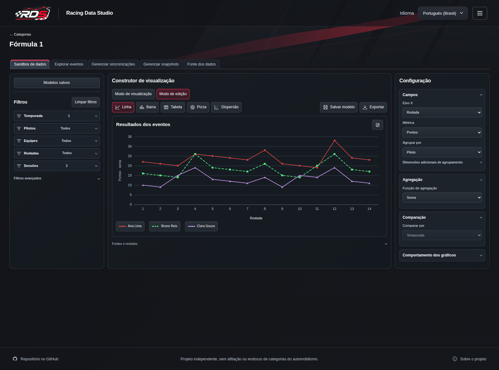
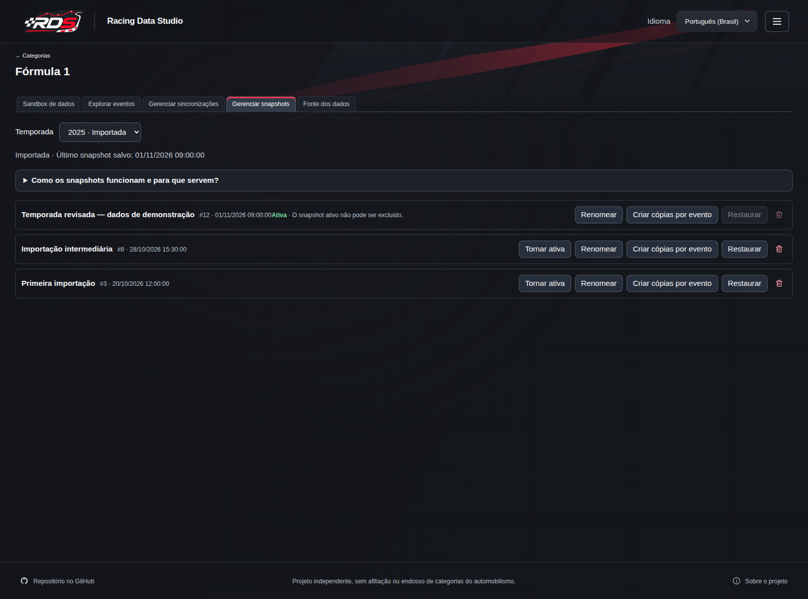

# Racing Data Studio

> [!WARNING]
> **BETA:** versão em pré-lançamento e avaliação; faça backup dos seus dados antes de testar. Sua contribuição é bem-vinda: leia o [guia beta](docs/BETA.md) e [relate problemas ou sugira melhorias](https://github.com/GustavoCarisRezende/racing-data-studio/issues/new) usando o [modelo de contribuição](docs/models/CONTRIBUTION_TEMPLATE.md).

Aplicativo desktop gratuito, open source e **local-first** para explorar dados de automobilismo sem escrever SQL. A Fórmula 1 é a única categoria funcional nesta primeira beta; os resultados são exploratórios, **não classificações oficiais**.

*Exemplo ilustrativo com dados simulados.*

## O que você pode fazer

- Importar manualmente temporadas da Jolpica e explorar calendário, corridas e sprints já disponíveis; dados importados podem ser consultados localmente.
- Criar tabelas e gráficos de linha, barras, pizza e dispersão; filtrar e comparar temporadas, pilotos e equipes. Métricas e acumulados dependem dos dados e das regras disponíveis, não de classificação oficial.
- Salvar modelos reutilizáveis, gerenciar snapshots e exportar tabelas CSV ou gráficos SVG/PNG.
- Usar a interface em português ou inglês e acompanhar o tutorial opcional de primeiro acesso.

*Análise ilustrativa com dados simulados.*

*Snapshots ilustrativos com dados simulados.*

*Tutorial ilustrativo com dados simulados.*

## Comece pela beta

Consulte [Releases](https://github.com/GustavoCarisRezende/racing-data-studio/releases) para verificar se há versões e arquivos disponíveis; este link não implica publicação ou instaladores validados. Para compilar, veja [desenvolvimento e arquitetura](docs/DEVELOPMENT.md). Linux é a plataforma dos testes realizados; Windows e macOS ainda precisam de validação. Veja as ressalvas e instruções acessíveis no [guia beta](docs/BETA.md).

## Dados e responsabilidade

A importação exige internet; consultas já importadas são locais. A fonte pode estar incompleta ou indisponível. Snapshots são versões no mesmo banco, **não backups independentes**. A exclusão de dados é permanente. Corridas em andamento, alterações de regulamento e regras históricas não são necessariamente refletidas nas análises.

Dados: [Jolpica F1 API](https://github.com/jolpica/jolpica-f1), contribuidores Jolpica, [CC BY-NC-SA 4.0 e termos da fonte](https://github.com/jolpica/jolpica-f1/blob/main/TERMS.md), incluindo uso não comercial. Confira os termos atuais antes de usar ou distribuir. O código do projeto está sob [Apache-2.0](LICENSE). O projeto não é afiliado, aprovado ou endossado pela Fórmula 1.

## Documentação

- [Guia de uso](docs/USER_GUIDE.md) · [Guia beta e contribuição](docs/BETA.md) · [Modelo de issue](docs/models/CONTRIBUTION_TEMPLATE.md)
- [Índice da documentação](docs/README.md) · [Desenvolvimento, arquitetura, segurança e testes](docs/DEVELOPMENT.md)
- [Pacotes da sandbox](packages/README.md) · [Usabilidade e snapshots](docs/DESKTOP_USABILITY.md) · [Identidade visual](docs/IDENTIDADE_VISUAL.md)
- Os demais documentos em `docs/` incluem contratos, handoffs e registros históricos; datas e ressalvas identificam o contexto de cada revisão.
