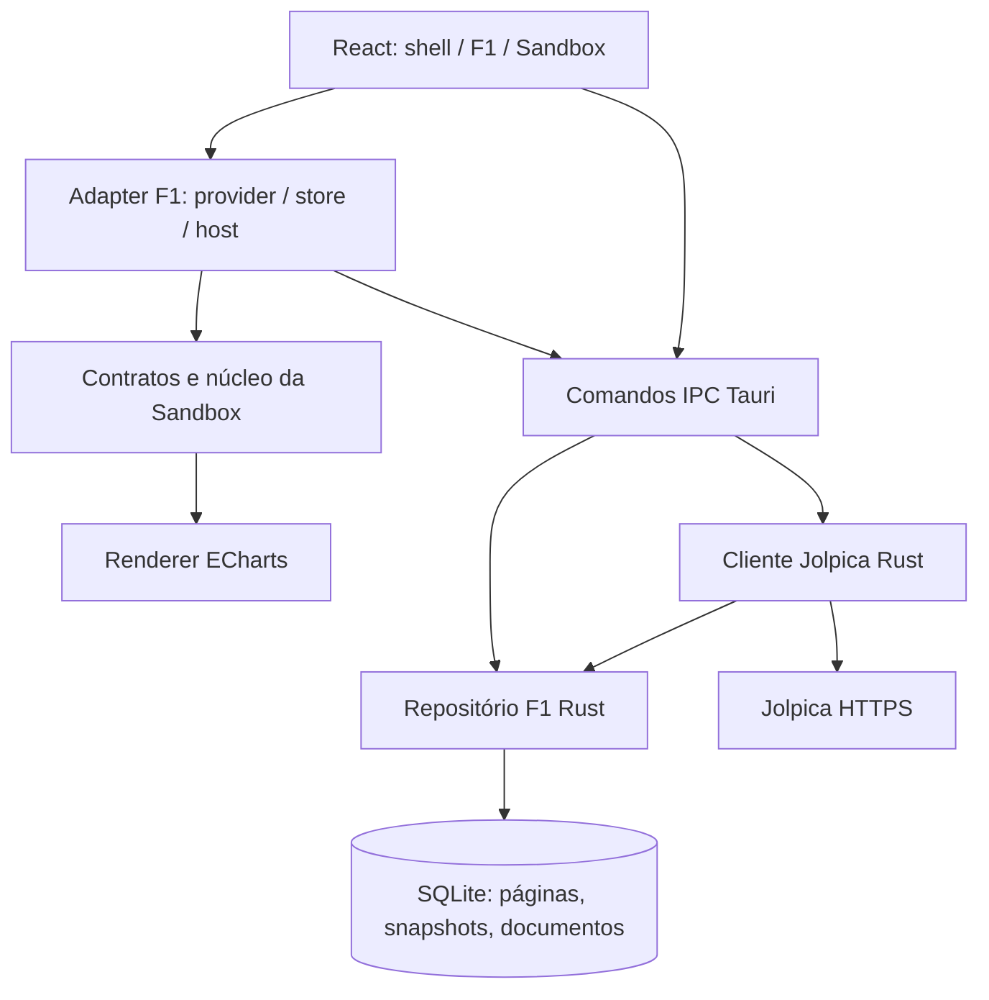

# Desenvolvimento e arquitetura da beta

Esta documentação descreve o código atual. A versão atual do código é `0.1.0`; o canal é beta. Os artefatos anunciados em Releases definem a disponibilidade. Linux recebeu testes; Windows e macOS, seus instaladores e o uso completo em Wayland nativo ainda precisam de validação.

## Arquitetura e dados

`app/` contém React/TypeScript/Vite e o shell Tauri 2/Rust. O registro em `app/src/categories/` isola categorias; F1 é a única funcional. `app/src-tauri/src/f1/` é dono de rede, repositório e regras F1. `packages/` fornece contratos, núcleo, UI React e renderer ECharts independentes da categoria; o host injeta provider, store e serviços. Veja [contrato v1](SANDBOX_INTEGRATION.md), [handoff v2](SANDBOX_V2_HANDOFF.md), [v3](SANDBOX_V3_ACCUMULATION.md) e [pacotes](../packages/README.md). Os contratos de protocolo, documento, transformação e esquema são versionados separadamente; documentos incompatíveis não devem ser reinterpretados silenciosamente.

### Mapa do código

| Caminho | Responsabilidade |
|---|---|
| `app/src/main.tsx`, `onboarding*.ts*` | Shell, idioma, navegação, ajuda e tutorial |
| `app/src/categories/f1/` | Telas F1, adapter/provider analítico, store e serviços de exportação |
| `app/src-tauri/src/main.rs`, `desktop.rs`, `reset.rs` | Registro de comandos, janela, link fixo, reset/reinício |
| `app/src-tauri/src/f1/commands.rs` | Limite IPC, validações iniciais e despacho de trabalho bloqueante |
| `app/src-tauri/src/f1/{repository.rs,jolpica.rs,event_archive.rs}` | SQLite/migrations, cliente remoto e cópias por evento |
| `app/src-tauri/src/f1/{saved_analysis.rs,saved_models.rs,migrations/}` | Validação/persistência de documentos e evolução de schema |
| `packages/sandbox-{contracts,core,react,echarts}/` | Contratos, transformações, editor e renderer compartilhados |
| `app/tests/`, `packages/tests/`, testes Rust junto aos módulos | Testes com escopos e fixtures distintos |
| `scripts/reset-local-data.py` | Ferramenta manual Linux, separada do reset nativo |



No fluxo analítico, o IPC entrega páginas/revisões locais e o adapter TypeScript projeta e agrega em memória; o diagrama não implica que cada query seja executada por SQL ou Rust. Gráficos não consultam a rede. O catálogo/importador remoto usa Rust; `latest` não significa download.

O SQLite `categories/f1.sqlite` fica no diretório de dados do app. As migrações são transacionais até o esquema **10** e rejeitam versões futuras. As páginas JSON importadas são fonte local autoritativa; consultas projetam seus dados. A migração 9 acrescenta nomes e a 10 registra o snapshot ativo, inicialmente o de maior ID. `latest` no contrato de modelos resolve o **ativo**, não necessariamente o maior ID; uma seleção resolvida fica congelada enquanto usada. Análises legadas fixam revisões e podem falhar se seus snapshots forem excluídos. Excluir snapshot ativo é proibido, mas referências legadas não bloqueiam exclusão.

A sincronização paginada valida origem, páginas e cobertura detectável contra a versão mais recente salva, não contra uma versão histórica ativada. Cada sucesso grava e ativa novo snapshot, inclusive conteúdo idêntico (que preserva data de origem). Falhas preservam versões anteriores. Essas verificações não provam completude; correções legítimas podem ser recusadas. Uma trava cooperativa em memória e arquivo limita concorrência local; não coordena máquinas. Cópias por evento são manuais, suplementares e disponíveis no Linux; não são restauração nem backup.

### Migrations e tabelas

`repository.rs` executa as migrations pendentes em uma transação `IMMEDIATE`, atualizando `PRAGMA user_version`; erro provoca rollback. A versão 10 é a máxima suportada. Faça backup separado com o app fechado antes de trocar de versão: não há downgrade automático garantido.

| Versão / arquivo em `app/src-tauri/src/f1/migrations/` | Efeito |
|---|---|
| `001_initial.sql` | Cria `seasons` com identidade por ano. |
| `002_snapshots.sql` | Cria `f1_imports` e `f1_import_pages` para snapshots e páginas originais. |
| `003_restore_provenance.sql` | Adiciona `source_imported_at` a importações para preservar origem da restauração. |
| `004_saved_analyses.sql` | Cria `f1_saved_analyses`, documentos fixados com revisão. |
| `005_saved_models.sql` | Cria `f1_saved_models`, documentos reutilizáveis com revisão. |
| `006_model_v3.sql` | Cria índice de revisão em modelos e estabelece gate de compatibilidade v3. |
| `007_default_models.sql` | Gate da política de padrões; o código Rust cria padrões apenas em banco novo, não recria exclusões num upgrade. |
| `008_grouped_calculation.sql` | Gate do perfil acumulado por equipe/piloto; não modifica linhas. |
| `009_snapshot_metadata.sql` | Cria metadados de nomes exclusivos por temporada. |
| `010_active_snapshot.sql` | Cria seleção ativa por temporada e inicializa com maior ID existente. |

`seasons` identifica anos; `f1_imports` identifica capturas e tempos; `f1_import_pages` guarda JSON por endpoint e offset; `f1_snapshot_metadata` guarda rótulos, sem alterar conteúdo; `f1_active_snapshots` aponta a captura escolhida; `f1_saved_analyses` e `f1_saved_models` guardam documentos e revisões para controle otimista. Não são tabelas normalizadas de pilotos ou resultados: as páginas são projetadas em consultas.

| Seleção | Efeito |
|---|---|
| Ativa | Usada na exploração e resolução inicial de modelos; pode ser histórica. Ativar não copia. |
| Mais recente armazenada | Maior ID; referência para detectar regressões na sincronização, mesmo se outra estiver ativa. |
| `latest` de modelo | Resolve a ativa local no momento da abertura; depois a seleção é congelada para consultas/facetas. |
| `pinned` de análise legada | Exige as revisões originais e transformação compatível; não faz fallback silencioso. |

Restaurar uma captura anterior valida e copia seu conteúdo para nova captura ativa; restaurar a já ativa pode ser uma operação sem cópia. Renomear o próprio nome automático sem nome personalizado não grava metadados. Excluir uma captura não ativa pode quebrar análise fixada: suas referências não bloqueiam a exclusão.

### Comandos IPC

Os nomes abaixo são Rust; o transporte Tauri converte nomes de argumentos conforme sua convenção JavaScript. `app`, `state` e `window` são injetados, não escolhidos como caminhos pelo frontend. Para assinatura exata e validação, consulte `commands.rs`, `desktop.rs` e `reset.rs`.

| Grupo e comandos | Parâmetros principais / finalidade |
|---|---|
| `f1_remote_seasons`, `f1_local_seasons`, `f1_sync_status` | Sem argumentos de usuário: catálogo remoto, temporadas locais e progresso. |
| `f1_sync`, `f1_season_details`, `f1_snapshots` | `year`: importar, ler evento/resultados ativos ou listar histórico. |
| `f1_analysis_snapshots`, `f1_analysis_pinned` | Sem argumentos ou `revisions`: ler capturas ativas ou revisões fixadas. |
| `f1_analyses_list`, `f1_analysis_load/save/delete` | Lista ou `id`; gravação usa `document` e `expected_revision`, exclusão usa `id` e revisão esperada. |
| `f1_models_list`, `f1_model_load/save/delete` | Store v2; `id`, `document`, `expected_revision` conforme operação. |
| `f1_models_v3_list`, `f1_model_v3_load/save/delete`, `f1_models_restore_defaults` | Store v3 lê v2/v3; mesmos argumentos CRUD. Restaurar padrões ausentes não recebe documento e não sobrescreve existentes. |
| `f1_snapshot_rename/activate/delete` | `year`, `snapshot_id`, e `name` na renomeação. |
| `f1_restore_snapshot`, `f1_copy_snapshot_events` | `year`, `id`; restaurar ou criar projeções suplementares por evento, estas apenas no Linux. |
| `f1_export_text` | `kind` (`csv`, `svg`, `png`) e `content`; seletor nativo escolhe o destino, sem caminho arbitrário do frontend. |
| `reset_application`, `open_github`, `toggle_fullscreen` | Sem argumentos de usuário; reset confirmado na UI, URL fixa e alternância de tela cheia. |

`build.rs` declara os comandos e `capabilities/f1-main.json` atribui permissões à janela `main`. `reset_application`, `open_github` e `toggle_fullscreen` também verificam a janela explicitamente; os comandos F1 não devem ser descritos como tendo todos esse mesmo guard interno: sua autorização de janela depende da capability. Restrições e validações do backend continuam necessárias; não confiar apenas na UI.

### Métricas e semântica

Pontos usam soma, média, mínimo e máximo; ausências participantes propagam nulo. Decimais são agregados exatamente, com média arredondada nos empates para longe de zero e pelo menos 12 casas ou a precisão da origem. Gráficos usam aproximação numérica; para valores exatos consulte tabela/CSV. Não inferir zeros nem classificação oficial.

Grid, posição final e saldo (`grid - posição final`) aceitam média/mínimo/máximo, não soma; grid zero é desconhecido, e um dos operandos ausente torna saldo nulo. Saldo positivo indica posições ganhas, não número de ultrapassagens. Voltas completadas aceitam soma/média/mínimo/máximo e zero é válido. Contagem mede ocorrências. Posições exigem sessão no grão; unificação de corrida/sprint reagrupa ocorrências, não cria uma posição oficial do evento. Acumulados dependem de população e cronologia válidas; faltas de horário/ordem podem produzir erro, e dados da fonte podem estar incompletos.

## Pré-requisitos e comandos

Use Node compatível com ambos workspaces: `^22.22.2 || ^24.15.0 || >=26.0.0`. Instale Rust/Cargo e os [pré-requisitos Tauri para o sistema](https://v2.tauri.app/start/prerequisites/), inclusive compilador C, pkg-config, WebKitGTK 4.1, GTK 3 e libsoup 3 no Linux; siga a lista específica da distribuição no link. Confira `node --version`, `npm --version`, `rustc --version` e `cargo --version`. Uma validação anterior usou Rust/Cargo 1.99.1; não é um requisito mínimo comprovado. Dependências diretas e lockfiles estão fixados; não há toolchain Rust pinada no repositório. `npm ci --ignore-scripts` evita scripts de dependências; verifique procedência e lockfiles.

```sh
cd packages
npm ci --ignore-scripts
npm run build
cd ../app
npm ci --ignore-scripts
npm run build
npm run tauri dev
```

Vite resolve os pacotes privados a partir de `packages/*/dist` e deduplica React. Recompile os pacotes após alterações neles. `npm run dev` é apenas prévia web, não valida IPC nem acesso a dados desktop. `npm run tauri dev` primeiro gera `app/dist` e inicia Vite. O bundle Tauri está desativado na configuração; não pressupor instaladores publicados ou testados.

## Testes e recursos

Execute testes somente em ambiente apropriado, com dados isolados e limites de memória e tempo; não use o banco pessoal. `npm test` usa concorrência padrão do Node; os exemplos abaixo invocam explicitamente um arquivo de teste por vez (`--test-concurrency=1`) e compilam os pacotes antes. Testes do app incluem integração Vite. Em Linux com systemd de usuário, exemplos a partir da raiz, executados separadamente:

```sh
systemd-run --user --scope -p MemoryMax=3G -p MemorySwapMax=0 -p TasksMax=256 timeout 15m bash -c 'cd packages && export NODE_OPTIONS=--max-old-space-size=1536 && npm run build && node --test --test-concurrency=1 tests/*.test.mjs'
systemd-run --user --scope -p MemoryMax=3G -p MemorySwapMax=0 -p TasksMax=256 timeout 15m bash -c 'cd app && NODE_OPTIONS=--max-old-space-size=1536 node --experimental-strip-types --test --test-concurrency=1 tests/*.test.mjs'
systemd-run --user --scope -p MemoryMax=4G -p MemorySwapMax=0 -p TasksMax=256 timeout 30m bash -c 'cd app && CARGO_BUILD_JOBS=1 cargo test --manifest-path src-tauri/Cargo.toml --locked'
```

A disponibilidade de cgroups/systemd varia. Suítes não substituem teste visual nativo, acessibilidade ou desempenho. O teste de rede `live_read_only_smoke` é ignorado por padrão e consulta a fonte real se executado explicitamente. Audite dependências com `npm audit` em cada workspace e ferramenta Rust confiável como `cargo audit`; esses comandos exigem rede e não comprovam segurança completa. Registros anteriores de execução são históricos, não promessa de validação desta revisão.

| Camada | Verificar | Limitação |
|---|---|---|
| Unitária e contratos | Validação, decimais, filtros, versões e conflitos em `packages/tests/`; lógica Rust em testes de módulo | Fixtures não provam IPC ou apresentação nativa. |
| Integração | Adapter F1 com readers sintéticos, migrações/repositório em banco temporário, build dos workspaces | Isolar dados e não presumir acesso à rede ou dados reais. |
| UI | jsdom e testes da aplicação; inspeção visual com dados simulados | jsdom não valida layout, leitor de tela ou CSP real. |
| Desktop nativo | Importar, reabrir offline, ativar/restaurar, exportar/cancelar, tutorial e reset em perfil XDG isolado | Usar dados descartáveis, diretórios separados e backup; Linux testado parcialmente, outras plataformas pendentes. |

### Checklist antes de disponibilizar uma beta

- [ ] Confirmar versão/canal e notas de mudanças, sem renomear versões declaradas sem decisão de release.
- [ ] Executar testes isolados, builds e validação nativa para cada plataforma anunciada; registrar escopo e pendências.
- [ ] Verificar migrations, atualização, rollback operacional por backup, recuperação, reset e ausência de dados pessoais no artefato.
- [ ] Revisar dependências, lockfiles, auditorias, licenças, avisos, atribuição Jolpica e SBOM do produto.
- [ ] Verificar CSP/capabilities, limites de exportação, acessibilidade, privacidade e condições da fonte.
- [ ] Decidir e validar empacotamento, assinaturas e distribuição; conferir artefatos e instruções apenas quando existirem.
- [ ] Atualizar notas de release, limitações e link de downloads após publicação efetiva; o link [Releases](https://github.com/GustavoCarisRezende/racing-data-studio/releases) por si só não comprova publicação.

## Reset e recuperação de desenvolvimento

O comando nativo `reset_application` é autorizado pela capability da janela `main`. A confirmação prepara reset e reinício; na próxima inicialização a limpeza ocorre antes de banco e WebView. Em Linux, as raízes de dados, configuração, cache e estado do aplicativo são afetadas; exportações fora delas não são removidas. É irreversível: feche e faça backup independente antes. O binário não executa nem requer Python para esse reset. O script opcional `scripts/reset-local-data.py` é ferramenta separada de desenvolvimento Linux: sem `--yes` mostra os destinos; consulte [detalhes e proteção de caminhos](DESKTOP_USABILITY.md).

Em desenvolvimento, após o reset o processo reaberto usa a cópia local `app/dist` via protocolo interno, pois o CLI pode encerrar o servidor Vite. A cópia é validada antes do reset; se inválida ou ausente, a operação é recusada. Essa instância de recuperação não tem HMR: encerre-a e volte a executar `npm run tauri dev` para retomar HMR. O início normal usa Vite. Testes de reset devem usar raízes XDG isoladas; não executar contra dados reais.

## Segurança, licença e limites

A capability limita comandos à janela local `main`; a CSP não concede rede Jolpica diretamente ao WebView. Rust usa HTTPS com URL fixa, paginação e limites/tentativas; cotas são compartilhadas por IP e podem mudar. O seletor nativo escolhe destino de exportação; não há permissão genérica de filesystem ao frontend. Exportações não sobrescrevem silenciosamente e têm limites de tamanho. Consulte [segurança dos pacotes](../packages/SECURITY.md) e [pizza/exportação](SANDBOX_PIE_EXPORT.md).

Código [Apache-2.0](../LICENSE); dados [Jolpica F1](https://github.com/jolpica/jolpica-f1) sob termos próprios, incluindo CC BY-NC-SA 4.0 e uso não comercial. Verifique licença, atribuição e termos atuais antes de distribuir. Não é aconselhamento jurídico nem afiliação à Fórmula 1.
