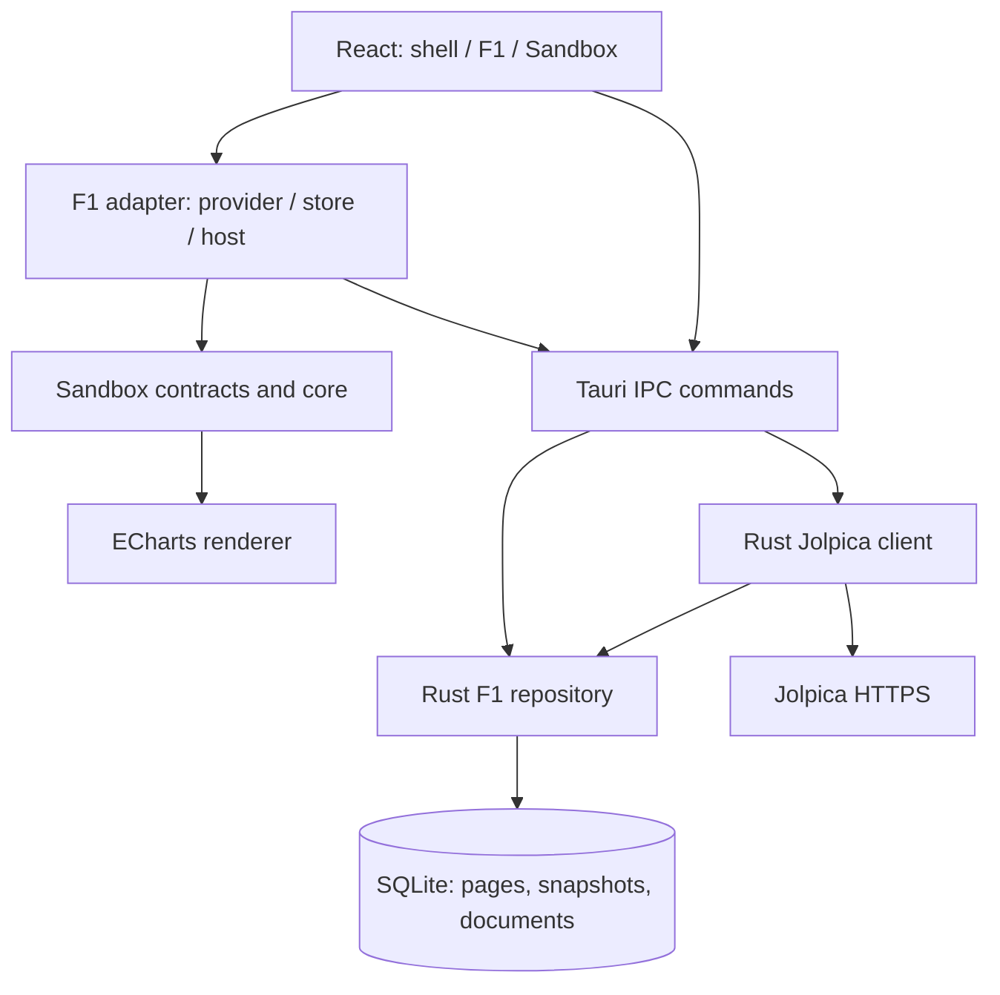

# Development and architecture

This documentation describes the current code. The application is being prepared as `0.0.1-beta.1`; this version is not a claim of publication. See [release implementation status](RELEASING.md). Artifacts announced in Releases determine availability. Linux has received testing; Windows, macOS, their installers, and full native Wayland operation still require validation.

## Architecture and data

`app/` contains React/TypeScript/Vite and the Tauri 2/Rust shell. The registry in `app/src/categories/` isolates categories; F1 is the only functional category. `app/src-tauri/src/f1/` owns F1 networking, storage, and rules. `packages/` provides category-independent contracts, core logic, React UI, and the ECharts renderer; the host injects the provider, store, and services. See the [v1 contract](SANDBOX_INTEGRATION.md), [v2 handoff](SANDBOX_V2_HANDOFF.md), [v3](SANDBOX_V3_ACCUMULATION.md), and [packages](packages/README.md). Protocol, document, transformation, and schema contracts are versioned separately; incompatible documents must not be silently reinterpreted.

### Code map

| Path | Responsibility |
|---|---|
| `app/src/main.tsx`, `onboarding*.ts*` | Shell, language, navigation, help, and tutorial |
| `app/src/categories/f1/` | F1 screens, analytical adapter/provider, store, and export services |
| `app/src-tauri/src/main.rs`, `desktop.rs`, `reset.rs` | Command registration, window, fixed link, reset/restart |
| `app/src-tauri/src/f1/commands.rs` | IPC boundary, initial validation, and blocking-work dispatch |
| `app/src-tauri/src/f1/{repository.rs,jolpica.rs,event_archive.rs}` | SQLite/migrations, remote client, and per-event copies |
| `app/src-tauri/src/f1/{saved_analysis.rs,saved_models.rs,migrations/}` | Document validation/persistence and schema evolution |
| `packages/sandbox-{contracts,core,react,echarts}/` | Shared contracts, transformations, editor, and renderer |
| `app/tests/`, `packages/tests/`, Rust tests alongside modules | Tests with different scopes and fixtures |
| `scripts/reset-local-data.py` | Manual Linux tool, separate from native reset |



In the analytical flow, IPC delivers local pages/revisions and the TypeScript adapter projects and aggregates them in memory; the diagram does not imply that every query runs in SQL or Rust. Charts do not access the network. The remote catalog/importer uses Rust; `latest` does not mean downloading.

The SQLite database `categories/f1.sqlite` lives in the application's data directory. Migrations are transactional through schema **10** and reject future versions. Imported JSON pages are the authoritative local source; queries project their data. Migration 9 adds names and migration 10 records the active snapshot, initially the highest-ID snapshot. In the model contract, `latest` resolves the **active** snapshot, not necessarily the highest ID; a resolved selection remains frozen while in use. Legacy analyses pin revisions and may fail if their snapshots are deleted. Deleting the active snapshot is prohibited, but legacy references do not block deletion.

Paginated synchronization validates origin, pages, and detectable coverage against the most recently saved version, not an activated historical version. Every successful synchronization saves and activates a new snapshot, including identical content (which preserves the source date). Failures preserve previous versions. These checks do not prove completeness; legitimate corrections may be rejected. Cooperative in-memory and file locks limit local concurrency; they do not coordinate machines. Per-event copies are manual, supplemental, and available on Linux; they are neither restoration nor database backups.

### Migrations and tables

`repository.rs` runs pending migrations in an `IMMEDIATE` transaction, updating `PRAGMA user_version`; errors cause rollback. Version 10 is the highest supported version. Automatic downgrade is not guaranteed.

| Version / file in `app/src-tauri/src/f1/migrations/` | Effect |
|---|---|
| `001_initial.sql` | Creates `seasons`, identified by year. |
| `002_snapshots.sql` | Creates `f1_imports` and `f1_import_pages` for snapshots and original pages. |
| `003_restore_provenance.sql` | Adds `source_imported_at` to imports to preserve restoration provenance. |
| `004_saved_analyses.sql` | Creates `f1_saved_analyses`, revisioned pinned documents. |
| `005_saved_models.sql` | Creates `f1_saved_models`, revisioned reusable documents. |
| `006_model_v3.sql` | Creates a model revision index and establishes a v3 compatibility gate. |
| `007_default_models.sql` | Default-model policy gate; Rust creates defaults only in a new database, not to reverse deletions during upgrades. |
| `008_grouped_calculation.sql` | Gate for the team/driver accumulation profile; does not modify rows. |
| `009_snapshot_metadata.sql` | Creates metadata for names unique within a season. |
| `010_active_snapshot.sql` | Creates the active selection per season and initializes it with the highest existing ID. |

`seasons` identifies years; `f1_imports` identifies snapshots and timestamps; `f1_import_pages` stores JSON by endpoint and offset; `f1_snapshot_metadata` stores labels without changing content; `f1_active_snapshots` points to the selected snapshot; `f1_saved_analyses` and `f1_saved_models` store documents and revisions for optimistic concurrency control. These are not normalized driver or result tables: pages are projected during queries.

| Selection | Effect |
|---|---|
| Active | Used for exploration and initial model resolution; may be historical. Activation does not copy data. |
| Most recently stored | Highest ID; the reference for detecting synchronization regressions even when another snapshot is active. |
| Model `latest` | Resolves the local active snapshot when opened; the selection is then frozen for queries/facets. |
| Legacy analysis `pinned` | Requires original revisions and a compatible transformation; no silent fallback. |

Restoring an earlier snapshot validates and copies its content into a new active snapshot; restoring the already active snapshot may perform no copy. Confirming its own automatic name without a custom name does not write metadata. Deleting an inactive snapshot may break a pinned analysis: its references do not block deletion.

### IPC commands

The names below are Rust names; Tauri converts argument names according to its JavaScript convention. `app`, `state`, and `window` are injected, not frontend-selected paths. See `commands.rs`, `desktop.rs`, and `reset.rs` for exact signatures and validation.

| Group and commands | Main parameters / purpose |
|---|---|
| `f1_remote_seasons`, `f1_local_seasons`, `f1_sync_status` | No user arguments: remote catalog, local seasons, and progress. |
| `f1_sync`, `f1_season_details`, `f1_snapshots` | `year`: import, read active events/results, or list history. |
| `f1_analysis_snapshots`, `f1_analysis_pinned` | No arguments or `revisions`: read active snapshots or pinned revisions. |
| `f1_analyses_list`, `f1_analysis_load/save/delete` | List or `id`; saving uses `document` and `expected_revision`, deletion uses `id` and the expected revision. |
| `f1_models_list`, `f1_model_load/save/delete` | v2 store; `id`, `document`, `expected_revision` as appropriate. |
| `f1_models_v3_list`, `f1_model_v3_load/save/delete`, `f1_models_restore_defaults` | v3 store reads v2/v3; same CRUD arguments. Restoring missing defaults takes no document and does not overwrite existing models. |
| `f1_snapshot_rename/activate/delete` | `year`, `snapshot_id`, and `name` when renaming. |
| `f1_restore_snapshot`, `f1_copy_snapshot_events` | `year`, `id`; restore or create supplemental per-event projections, the latter Linux-only. |
| `f1_export_text` | `kind` (`csv`, `svg`, `png`) and `content`; a native picker selects the destination, with no arbitrary frontend path. |
| `reset_application`, `open_github`, `toggle_fullscreen` | No user arguments; UI-confirmed reset, fixed URL, and fullscreen toggle. |

`build.rs` declares commands and `capabilities/f1-main.json` grants permissions to the `main` window. `reset_application`, `open_github`, and `toggle_fullscreen` also explicitly check the window; do not describe all F1 commands as having this same internal guard: their window authorization depends on the capability. Backend restrictions and validation remain necessary; do not rely solely on the UI.

### Metrics and semantics

Points support sum, average, minimum, and maximum; missing participating values propagate null. Decimals are aggregated exactly, with averages rounded away from zero at ties and at least 12 decimal places or the source precision. Charts use numerical approximations; consult tables/CSV for exact values. Do not infer zeros or official standings.

Grid, finishing position, and position change (`grid - finishing position`) support average/minimum/maximum, not sum; grid zero is unknown, and either missing operand makes position change null. A positive change indicates positions gained, not an overtake count. Completed laps support sum/average/minimum/maximum and zero is valid. Count measures occurrences. Positions require session in the grain; race/sprint unification regroups occurrences, not an official event position. Accumulations require valid population and chronology; missing times/order may cause errors, and source data may be incomplete.

## Prerequisites and commands

Use Node compatible with both workspaces: `^22.22.2 || ^24.15.0 || >=26.0.0`. Install Rust/Cargo and the [Tauri system prerequisites](https://v2.tauri.app/start/prerequisites/), including a C compiler, pkg-config, WebKitGTK 4.1, GTK 3, and libsoup 3 on Linux; follow the distribution-specific list at that link. Check `node --version`, `npm --version`, `rustc --version`, and `cargo --version`. An earlier validation used Rust/Cargo 1.99.1; that is not a verified minimum requirement. Direct dependencies and lockfiles are pinned; the repository does not pin a Rust toolchain. `npm ci --ignore-scripts` avoids dependency scripts; verify provenance and lockfiles.

```sh
cd packages
npm ci --ignore-scripts
npm run build
cd ../app
npm ci --ignore-scripts
npm run build
npm run tauri dev
```

Vite resolves private packages from `packages/*/dist` and deduplicates React. Rebuild packages after changing them. `npm run dev` is only a web preview, not validation of IPC or desktop data access. `npm run tauri dev` first generates `app/dist` and starts Vite. Tauri bundling is disabled in configuration; do not assume installers are published or tested.

## Tests and resource limits

Run tests only in an appropriate environment, with isolated data and memory/time limits; do not use a personal database. `npm test` uses Node's default concurrency; the examples below explicitly run one test file at a time (`--test-concurrency=1`) and build packages first. App tests include Vite integration. On Linux with user systemd, run these examples separately from the repository root:

```sh
systemd-run --user --scope -p MemoryMax=3G -p MemorySwapMax=0 -p TasksMax=256 timeout 15m bash -c 'cd packages && export NODE_OPTIONS=--max-old-space-size=1536 && npm run build && node --test --test-concurrency=1 tests/*.test.mjs'
systemd-run --user --scope -p MemoryMax=3G -p MemorySwapMax=0 -p TasksMax=256 timeout 15m bash -c 'cd app && NODE_OPTIONS=--max-old-space-size=1536 node --experimental-strip-types --test --test-concurrency=1 tests/*.test.mjs'
systemd-run --user --scope -p MemoryMax=4G -p MemorySwapMax=0 -p TasksMax=256 timeout 30m bash -c 'cd app && CARGO_BUILD_JOBS=1 cargo test --manifest-path src-tauri/Cargo.toml --locked'
```

Availability of cgroups/systemd varies. Suites do not replace native visual, accessibility, or performance testing. The `live_read_only_smoke` network test is ignored by default and queries the real source if explicitly run. Audit dependencies with `npm audit` in each workspace and a trusted Rust tool such as `cargo audit`; these commands require network access and do not prove complete security. Earlier execution records are historical, not a claim that this documentation revision was tested.

| Layer | What to check | Limitation |
|---|---|---|
| Unit and contracts | Validation, decimals, filters, versions, and conflicts in `packages/tests/`; Rust logic in module tests | Fixtures do not prove IPC or native presentation. |
| Integration | F1 adapter with synthetic readers, migrations/repository in a temporary database, workspace builds | Isolate data; do not assume network or real-data access. |
| UI | jsdom and application tests; visual inspection with simulated data | jsdom does not validate layout, screen readers, or real CSP. |
| Native desktop | Import, reopen offline, activate/restore, export/cancel, tutorial, and reset in an isolated XDG profile | Use disposable data and separate directories; Linux partially tested, other platforms pending. |

### Checklist before making a version available

- [ ] Confirm version/channel and change notes without renaming declared versions outside a release decision.
- [ ] Run isolated tests, builds, and native validation for each announced platform; record scope and outstanding checks.
- [ ] Check migrations, upgrades, recovery, reset, and the absence of personal data in artifacts.
- [ ] Review dependencies, lockfiles, audits, licenses, notices, Jolpica attribution, and product SBOM.
- [ ] Check CSP/capabilities, export limits, accessibility, privacy, and source terms.
- [ ] Decide and validate packaging, signatures, and distribution; check artifacts and instructions only when they exist.
- [ ] Update release notes, limitations, and download links after actual publication; the [Releases](https://github.com/GustavoCarisRezende/racing-data-studio/releases) link alone does not prove publication.

## Reset and development recovery

The native `reset_application` command is authorized by the `main` window capability. Confirmation prepares reset and restart; cleanup takes place on the next startup, before the database and WebView open. On Linux, application data, configuration, cache, and state roots are affected; exports outside them are not removed. The operation is irreversible. The binary neither runs nor requires Python for this reset. The optional `scripts/reset-local-data.py` script is a separate Linux development tool: without `--yes`, it previews targets; see [details and path protection](DESKTOP_USABILITY.md).

In development, the reopened process after reset uses the local `app/dist` copy through an internal protocol because the CLI may stop Vite. The copy is validated before reset; the operation is refused if it is invalid or missing. This recovery instance has no HMR: close it and run `npm run tauri dev` again to resume HMR. Normal startup uses Vite. Reset tests must use isolated XDG roots, never real data.

## Security, licensing, and limits

The capability restricts commands to the local `main` window; CSP does not grant the WebView direct Jolpica network access. Rust uses HTTPS with a fixed URL, pagination, and limits/retries; quotas are shared per IP and may change. A native picker selects export destinations; the frontend has no generic filesystem permission. Exports do not silently overwrite files and have size limits. See [package security](packages/SECURITY.md) and [pie charts/export](SANDBOX_PIE_EXPORT.md).

Code is [Apache-2.0](../../LICENSE); [Jolpica F1](https://github.com/jolpica/jolpica-f1) data has its own terms, including CC BY-NC-SA 4.0 and noncommercial use. Check current licensing, attribution, and terms before distribution. This is neither legal advice nor Formula 1 affiliation.
