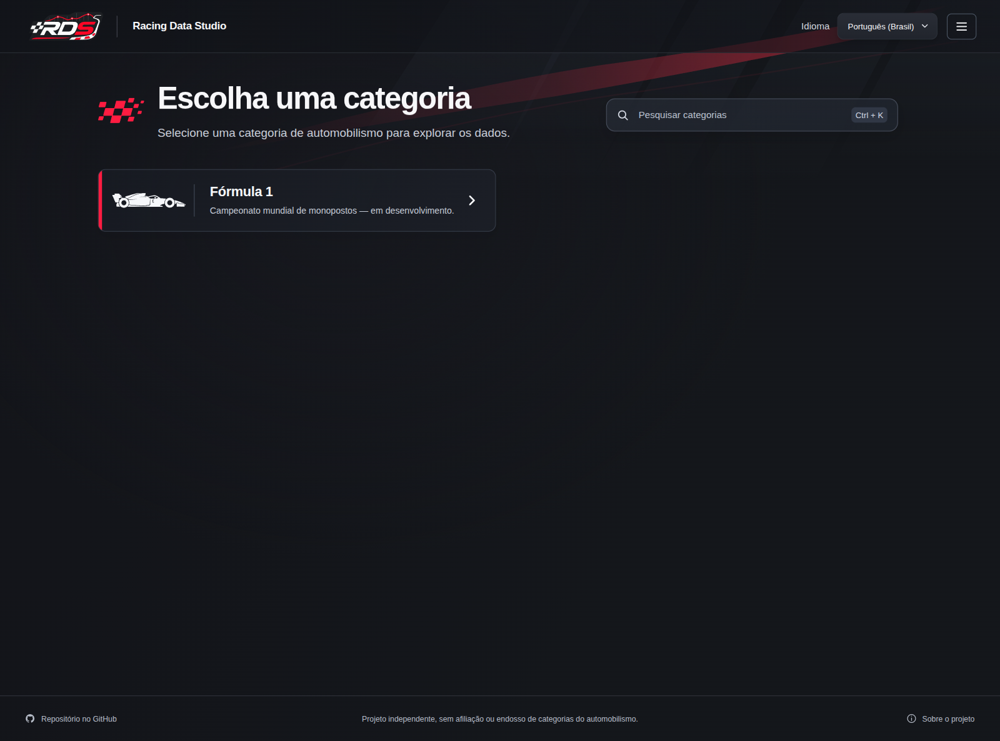
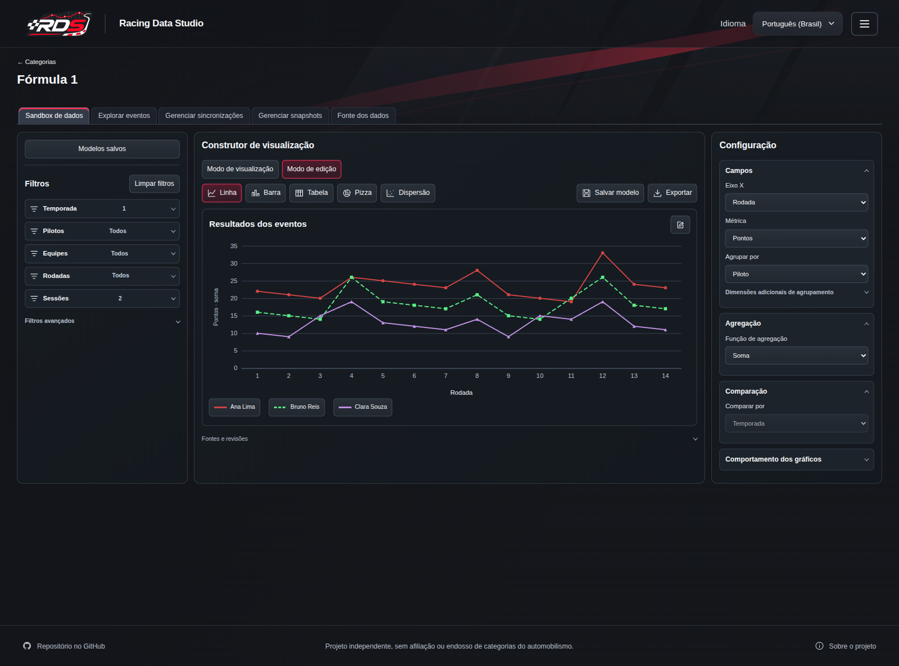
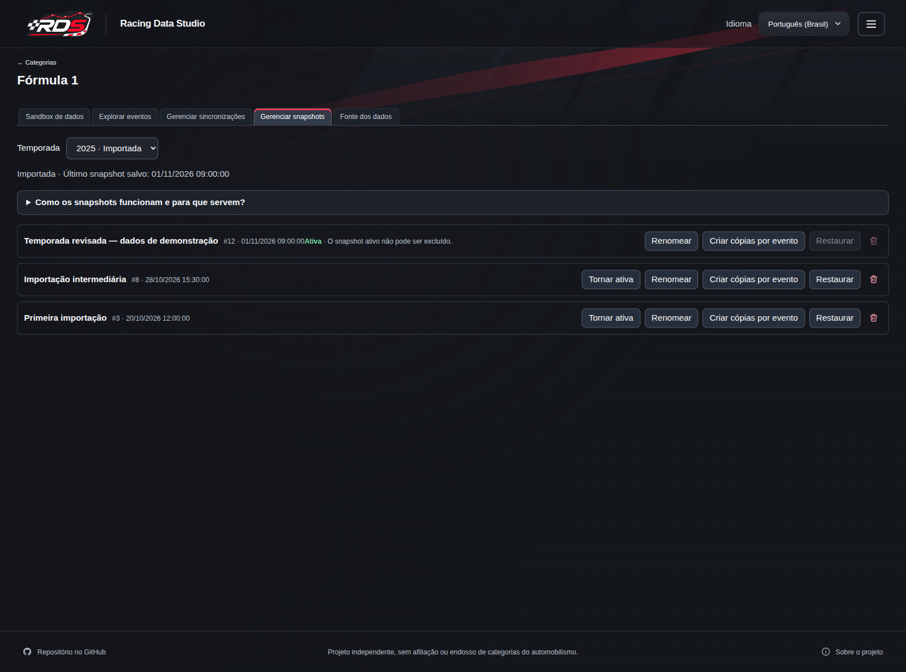
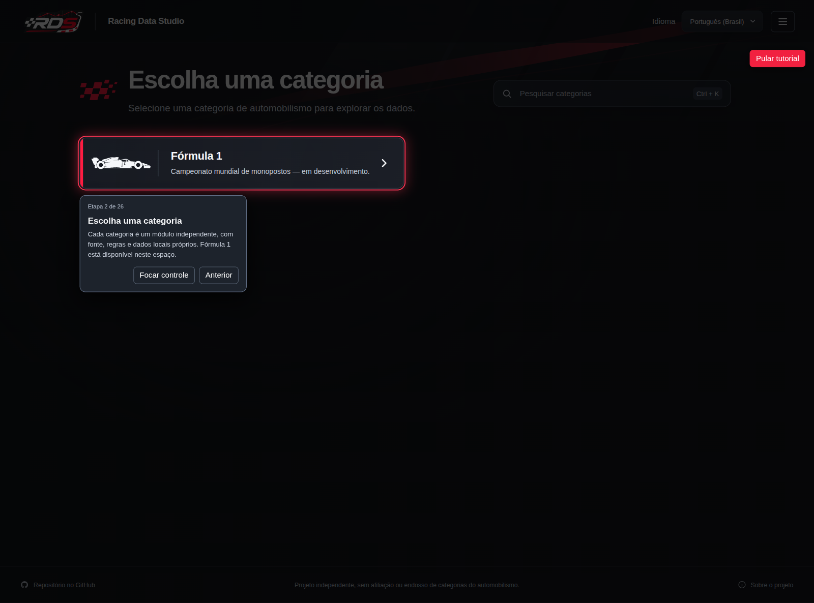

# Racing Data Studio

> [!WARNING]
> **Beta aberta:** ajude a testar o Racing Data Studio e aprimorar os detalhes finais. Sua contribuição é bem-vinda: leia o [guia de testes](BETA.md) e [relate problemas ou sugira melhorias](https://github.com/GustavoCarisRezende/racing-data-studio/issues/new) usando o [modelo de contribuição](models/CONTRIBUTION_TEMPLATE.md).

[English documentation](../../README.md)

Aplicativo desktop gratuito, open source e **local-first** para explorar dados de automobilismo sem escrever SQL. A Fórmula 1 é a única categoria funcional; os resultados são exploratórios, **não classificações oficiais**.

*Exemplo ilustrativo com dados sintéticos.*

## O que você pode fazer

- Importar manualmente temporadas da Jolpica e explorar calendários, corridas e sprints disponíveis; dados importados podem ser consultados localmente.
- Criar tabelas e gráficos de linha, barras, pizza e dispersão; filtrar e comparar temporadas, pilotos e equipes. Métricas e acumulados dependem dos dados e das regras disponíveis, não de classificação oficial.
- Salvar modelos reutilizáveis, gerenciar snapshots e exportar tabelas CSV ou gráficos SVG/PNG.
- Usar a interface em português ou inglês e acompanhar o tutorial opcional de primeiro acesso.

*Análise ilustrativa com dados sintéticos.*

*Snapshots ilustrativos com dados sintéticos.*

*Tutorial ilustrativo com dados sintéticos.*

## Primeiros passos

Consulte [Releases](https://github.com/GustavoCarisRezende/racing-data-studio/releases) para verificar as versões e os arquivos disponíveis. Para compilar, veja [desenvolvimento e arquitetura](DEVELOPMENT.md). Os testes se concentraram no Linux; Windows e macOS ainda precisam de validação. Veja como participar no [guia de testes](BETA.md).

## Dados e responsabilidade

A importação exige internet; consultas já importadas são locais. A fonte pode estar incompleta ou indisponível. Snapshots preservam versões locais dos dados importados. Corridas em andamento, alterações de regulamento e regras históricas não são necessariamente refletidas nas análises.

Dados: [Jolpica F1 API](https://github.com/jolpica/jolpica-f1), contribuidores Jolpica, [CC BY-NC-SA 4.0 e termos da fonte](https://github.com/jolpica/jolpica-f1/blob/main/TERMS.md), incluindo uso não comercial. Confira os termos atuais antes de usar ou distribuir. O código do projeto está sob [Apache-2.0](../../LICENSE). O projeto não é afiliado, aprovado ou endossado pela Fórmula 1.

## Documentação

- [Guia de uso](USER_GUIDE.md) · [Testes e contribuição](BETA.md) · [Modelo de issue](models/CONTRIBUTION_TEMPLATE.md)
- [Índice da documentação](../README.md) · [Desenvolvimento, arquitetura, segurança e testes](DEVELOPMENT.md)
- [Pacotes da sandbox](packages/README.md) · [Usabilidade e snapshots](DESKTOP_USABILITY.md) · [Identidade visual](IDENTIDADE_VISUAL.md)
- Os demais documentos em `docs/` incluem contratos, handoffs e registros históricos; datas e ressalvas identificam o contexto de cada revisão.

### Referências técnicas e históricas

- [Contrato de integração](SANDBOX_INTEGRATION.md) · [Handoff v2](SANDBOX_V2_HANDOFF.md) · [Acumulados v3](SANDBOX_V3_ACCUMULATION.md)
- [Tabela](SANDBOX_TABLE_V2.md) · [Agregações F1](SANDBOX_F1_AGGREGATIONS.md) · [Eventos e acumulados](SANDBOX_EVENT_BEHAVIOR.md) · [Pizza e exportação](SANDBOX_PIE_EXPORT.md)
- [Integração F1](F1_SANDBOX_V2_STATUS.md) · [Recuperação da UI](SANDBOX_UI_RECOVERY.md) · [Segurança dos pacotes](packages/SECURITY.md) · [Validação dos pacotes](packages/VALIDATION.md)
- [Revisão de 08/11](SANDBOX_UI.md) · [Revisão de 14/11](SANDBOX_FINAL_REVIEW.md). Os registros datados não descrevem necessariamente o estado atual.

## Para agentes de IA

Comece pelo [guia direto para agentes](AI_AGENTS.md).
